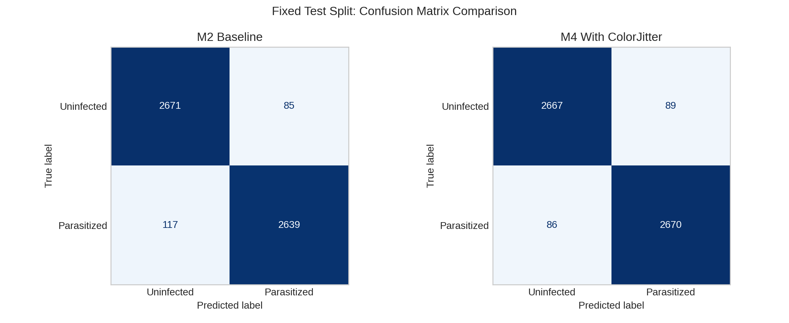

# Malaria Cell Detection

Malaria cell classification using DANet-S and mild colour augmentation. The
project reproduces a published baseline, evaluates training-only ColorJitter,
and analyses how individual prediction errors change.

Each input is a cropped red blood cell image labelled **Uninfected (0)** or
**Parasitized (1)**. The task is binary image classification; it does not cover
whole-slide detection or patient diagnosis.

## Project overview

The baseline is DANet-S with LogSoftMax from the DANet paper by Ali et al.
The experiment adds small random changes to brightness, contrast, saturation,
and hue during training. Both runs use the same network architecture, saved
data split, class labels, and test preprocessing.

The modified run achieves **96.83% test accuracy** and **96.88% recall**. It
misses 31 fewer infected cells than the baseline, while flagging four additional
uninfected cells. Recovery changed the training schedules, so the comparison
does not isolate the effect of ColorJitter.

## Report and experiment records

- [Final IEEE-format paper](milestone5/paper/malaria_danet_colorjitter_ieee.pdf)
- [Baseline reproduction](milestone2/README.md)
- [Recorded hypothesis and experiment plan](milestone3/03_prediction_and_experiment_plan.md)
- [ColorJitter experiment and comparison](milestone4/README.md)
- [Methods and reproducibility](milestone5/methods_and_reproducibility.md)
- [Failure analysis and final report](milestone5/README.md)

## Results

Both selected models were evaluated on the same 5,512 test images. Checkpoint
selection used the lowest validation loss: epoch 67 for the baseline and
epoch 62 for the modified run.

| Metric | Baseline | ColorJitter run | Change |
|---|---:|---:|---:|
| Accuracy | 96.34% | 96.83% | +0.49 pp |
| Precision | 96.88% | 96.77% | −0.11 pp |
| Recall / sensitivity | 95.75% | 96.88% | +1.12 pp |
| Specificity | 96.92% | 96.77% | −0.15 pp |
| F1-score | 96.31% | 96.83% | +0.51 pp |
| ROC-AUC | 0.9919 | 0.9940 | +0.0021 |
| Average precision | 0.9926 | 0.9946 | +0.0020 |
| Test loss | 0.110878 | 0.093517 | −0.017361 |
| False negatives | 117 | 86 | −31 |
| False positives | 85 | 89 | +4 |

Here, pp means percentage points. Parasitized is the positive class.

Total errors fell from 202 to 175. Comparing individual images, the modified
run corrected 79 baseline errors, introduced 52 new errors, and shared 123
errors with the baseline. All three success criteria recorded before
implementation were met. See the [evaluation summary](milestone4/model_evaluation/artifacts/evaluation_ablation_summary.md)
for the prediction assessment and interpretation.

The base paper reports 97.95% accuracy for DANet-S with LogSoftMax. Our
reproduced baseline is 1.61 percentage points below that reference; this
project uses one fixed split rather than repeating the paper's full
cross-validation study.

## Dataset and preprocessing

The public NIH/NLM Malaria Cell Images dataset contains 27,558 RGB images,
with 13,779 images in each class.

| Partition | Images | Use |
|---|---:|---|
| Training | 19,290 | Learn model parameters |
| Validation | 2,756 | Select the checkpoint |
| Test | 5,512 | Evaluate the selected models |

Both runs preserve the saved stratified image-level split with seed 42.
Images are resized to 224 × 224 pixels and scaled to 0–1. Baseline training
uses rotation within 15 degrees and horizontal and vertical flips, each with
probability 0.2.

The modified pipeline adds ColorJitter with brightness 0.2, contrast 0.2,
saturation 0.1, and hue 0.02. Validation and test images use only resizing
and tensor conversion.

The dataset must be downloaded separately and is not included in Git.
[NIH/NLM dataset page](https://lhncbc.nlm.nih.gov/LHC-research/LHC-projects/image-processing/malaria-datasheet.html).

## Repository structure

The milestone folders retain the stages in which the work was developed.

| Directory | Contents |
|---|---|
| [milestone1/](milestone1/) | Literature review and initial paper selection |
| [milestone2/](milestone2/) | Baseline data preparation, training, evaluation, and saved artifacts |
| [milestone3/](milestone3/) | Introduction, hypothesis, numerical predictions, and experiment plan |
| [milestone4/](milestone4/) | ColorJitter pipeline, modified-model training, and comparison |
| [milestone5/](milestone5/) | Methods, prediction failure analysis, and final IEEE paper |
| [src/](src/) | Reusable PyTorch DANet-S model |
| [docs/](docs/) | Background on the base-paper revision |

Notebook outputs are included for review. Supporting configurations, histories,
predictions, summaries, and figures are stored in each component's `artifacts/`
directory.

## Reviewing and running the work

To review the findings, start with the IEEE paper and the saved evaluation
and failure-analysis outputs. Reviewing these files does not require training
a model.

To work through the experiments in Google Colab:

1. Start with [baseline data preparation](milestone2/data_preparation/malaria_data_preparation_pipeline.ipynb),
   [training](milestone2/model_training/malaria_danet_training_evaluator_ready.ipynb),
   and [evaluation](milestone2/model_evaluation/malaria_danet_final_evaluation_evaluator_ready.ipynb).
2. Follow the modified experiment's [data preparation](milestone4/data_preparation/malaria_m4_data_preparation.ipynb),
   [training](milestone4/model_training/malaria_m4_danet_training.ipynb),
   and [evaluation](milestone4/model_evaluation/malaria_m4_evaluation_ablation.ipynb).
3. Use the saved predictions in the [failure-analysis notebook](milestone5/failure_analysis/malaria_m5_failure_analysis.ipynb).
   This analysis requires no model inference or retraining.

The notebooks use Google Drive under `MyDrive/malaria_danet/` for persistent
files and `/content/malaria_data/` for extracted images. Adjust paths to your
Drive layout and provide the required inputs before running. Training uses a
GPU. Software versions are recorded in the saved environment files.

Model checkpoints remain outside the repository. Their filenames and SHA-256
checksums are recorded in the training and evaluation configurations. Evaluating
the models again requires those checkpoints; saved predictions support review
of the reported metrics without them.

The M4 training notebook includes recovery records and a continuation workflow.
Its training invocation is disabled by default. Read its recovery sections
before running it; it is not an uninterrupted fresh-training script.

## Limitations

- The baseline used mixed precision through epoch 24; the modified run used it
  through epoch 22. Both then recovered in full precision with restarted
  optimizer and learning-rate schedules. This difference limits attribution
  solely to ColorJitter.
- Mapped patient identifiers overlap across the image-level partitions. These
  results are not a patient-independent evaluation.
- Results cover one dataset, split, and seed. External generalisation and
  statistical significance have not been established.
- No explicit stain-shift or lighting-shift robustness test was performed.
- Visual failure analysis covers 18 sampled images and does not establish
  error causes, label errors, or clinical validity.

## Team and contributions

| Member | Work |
|---|---|
| Manasa | Data preparation, augmentation pipeline, and prediction failure analysis |
| Shanker | Model training, recovery, hypothesis, and methods documentation |
| Vivekananda | Evaluation, experiment comparison, final IEEE paper, and project documentation |

See [CONTRIBUTIONS.md](CONTRIBUTIONS.md) for the recorded contributions and
[CONTRIBUTING.md](CONTRIBUTING.md) for the development workflow. Datasets,
archives, credentials, and model checkpoints are excluded from Git.

## Base paper

A. Ali et al., “DANet a lightweight dilated attention network for malaria
parasite detection,” *Scientific Reports*, vol. 15, article 36689, 2025.

- [Paper](https://doi.org/10.1038/s41598-025-20402-1)
- [Official implementation](https://github.com/asfakali/DANet)
- [Background on the change from the initial paper selection](docs/base_paper_revision_after_m1.md)
